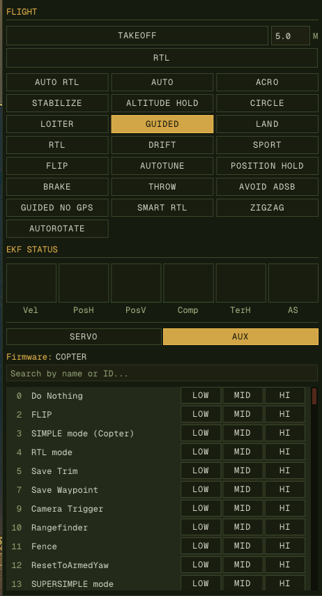

1. Navigate to the **FLIGHT** tab. Everything on it is disabled until a vehicle
   is heard from, and says `(no link)` beside the header while it is
2. **TAKEOFF** climbs to the altitude in the field beside it — metres above
   home, the same datum GO HERE uses
3. The mode grid is built from the vehicle's own **AVAILABLE_MODES** list where
   it publishes one, since `custom_mode` numbering is per airframe — a Plane's
   mode 4 is not a Copter's. Flight stacks that never answer fall back to the
   ArduCopter table. The current mode is lit, and hovering a button gives the
   full name the vehicle reported. **RTL** is one of these buttons rather than
   a control of its own — it is a flight mode like any other, and two ways to
   reach one mode is one more than an operator should have to think about
4. **EKF STATUS** below it shows variance bars for velocity, horizontal and
   vertical position, compass, terrain and airspeed
5. **SERVO** drives a servo output directly by PWM; **AUX** triggers any
   auxiliary function the connected firmware implements

**Force disarm** is for when the motors must stop and a plain disarm will not do: a
flyaway, or a person in danger. Click the **ARMED** block, or **DISARM** in the swarm
view, then **FORCE DISARM** at the bottom of the dialog. It sends
`MAV_CMD_COMPONENT_ARM_DISARM` with `21196` in its second parameter, which the vehicle
obeys even in flight, so an airborne aircraft falls. It takes the mouse: Enter and Y in
that dialog only ever mean the plain disarm. Agents have no such command.

**Message signing** stops anyone without the key from commanding a vehicle or posing as it.
Each connection has its own key, and does nothing until it's given one. In the **CONNECTION**
tab, **LINKS** numbers the connections: press **SIGNING** on one to open its settings. One is
open at a time.

1. Enter a passphrase, or press **GENERATE** and keep what it shows, then press **USE**. The
   key is the passphrase's SHA-256, as in MAVProxy and Mission Planner, so the same
   passphrase works there. **KEY** then shows a fingerprint to compare, never the key.
2. Disarm, and connect by USB or wired Ethernet: the key travels unencrypted. Press
   **SEND KEY** under the vehicle. Its line changes to **SIGNED** on its next heartbeat.
3. Once the vehicles on that connection are signing, turn on **REQUIRE SIGNED** to drop
   anything unsigned. A vehicle with no key then disappears, and can't be given one from here.

A connection is known by its settings, such as `tcp:192.168.1.1:5760`, so its key is there
again after a reconnect or a restart; connect with different settings, or to a serial port
that comes up under another name, and it has no key until you give it one. Commands are
signed once a key is set, which a vehicle with no key still accepts. Frames with a bad
signature are always dropped, and the link's row says so: a vehicle on another key shows up
only there, as a link that hears nothing. **SIGNS, THIS LINK HAS NO KEY** means it will ignore
every command: enter its passphrase. Keys are kept in `signing.json` beside
the settings, readable only by you.

**SAVED KEYS** keeps a key by name, so another connection can use it: type a name and press
**SAVE KEY**, then on the other link choose it and press **USE SAVED**. It's also how to keep
a key from **GENERATE** without writing the passphrase down. Each link already remembers its
own key, so this is only for reusing one. Saved keys are in `signing.json`, and aren't
encrypted there, so anyone with access to your account can read them. Keep your own copy of
any key you can't replace: if it's lost, a vehicle holding it can only be reset through its
first MAVLink port.

> **Signing does not lock ArduPilot's first MAVLink port.** It obeys anyone on that port, signed
> or not, so a lost key can be reset. That is normally USB, and on SITL it is `tcp:5760`, which
> is also where `sim_vehicle.py`'s MAVProxy connects, so anything relayed through MAVProxy gets
> in too. **SIGNED** means the vehicle's messages to you are genuine, not that this port is
> closed. Turning that port off doesn't help, because the next MAVLink port then becomes the
> first. On an aircraft, keep the radio on another port and control physical access to USB.
> To test on SITL, connect both ground stations to `tcp:5762` and `tcp:5763`, without MAVProxy.

  
