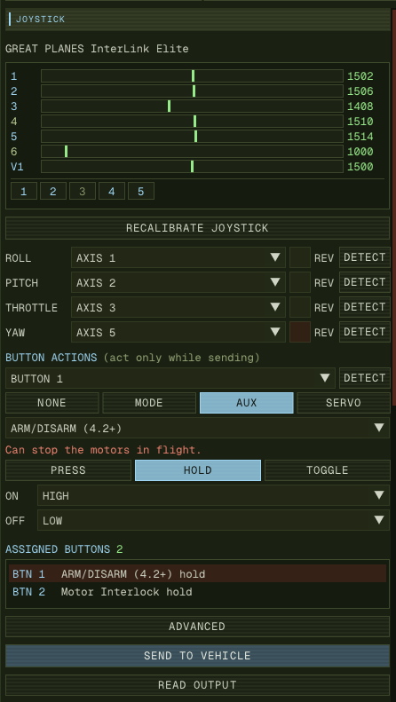
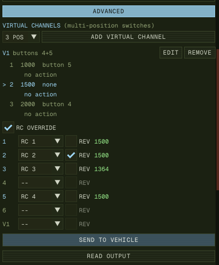

The **JOYSTICK** section sits at the top of the **RADIO** tab, tinted blue to keep
it apart from the **RADIO** section below it. It lets a USB joystick or a transmitter
in USB mode fly the vehicle over MAVLink, with no radio link.

Everything you set up here is saved on this computer, per device, and takes effect
on whichever vehicle you send to. It writes nothing to the vehicle's parameters, so a
real radio's `RC*_` calibration is never touched.

:::caution
This has been flown only against ArduPilot SITL. PX4, and flight on real hardware,
have not been tested. Do your first run on SITL or on the bench with the props off.
:::

## Before you start

**On the vehicle:**

| Stack | What it needs |
|---|---|
| ArduPilot | `MAV_GCS_SYSID` (`SYSID_MYGCS` on older firmware) must match this GCS, which is 255, the default. `RC_OPTIONS` must not have bit 1 (Ignore MAVLink Overrides) set |
| PX4 | `COM_RC_IN_MODE` must allow MAVLink input |
| Either | **An RC failsafe you have checked.** See [When sending stops](#when-sending-stops) |

**On this computer:** plug the joystick in and open **RADIO**. The strip reads
**NOT CONNECTED** until a device appears. On Linux, if it never does, your user cannot
read the device: check with `getfacl /dev/input/eventN`. Joysticks normally get access
automatically when you are logged in at the machine.

With more than one joystick connected, a list at the top of the section chooses
between them.

## The channel box

The box at the top is the live view of the device, and everything in it responds as
you move the stick.

- **Numbered rows** are the axes, with their raw value on a 1000 to 2000 scale. Many
  devices do not reach either end; calibration takes care of that.
- **V1, V2** rows are [virtual channels](#4-multi-position-switches), showing their
  virtual PWM.
- **The grid** is every button. A held button lights up solid, and a blue number means
  the button already has a job. Hover over one to see what it is tied to.

## 1. Calibrate

No vehicle is needed for this.

1. Press **CALIBRATE JOYSTICK**.
2. **1 / 3 CENTRE**: let the sticks return to centre, leave throttle where it rests,
   and press **CAPTURE**.
3. **2 / 3 SWEEP**: move every axis you intend to use to both stops. The amber band on
   each bar is the travel recorded so far. Press **FINISH** when the count stops rising.
4. **3 / 3 REVIEW**: check the count and press **SAVE**, or **DISCARD** to keep the
   previous calibration.

An axis you did not move cannot be used until you recalibrate, so sweep everything you
might want later. Repeat this with **RECALIBRATE JOYSTICK** if the stick is serviced or
changed.

## 2. Bind the sticks

Nothing is bound by default, because axis numbers differ between devices and operating
systems. For each of **ROLL**, **PITCH**, **THROTTLE** and **YAW**:

1. Press **DETECT**. The button changes to **PUSH**.
2. Push that stick the way it asks, and then let go:

| Control | Push it |
|---|---|
| ROLL | Right |
| PITCH | Forward |
| THROTTLE | Up |
| YAW | Right |

DETECT sets both the axis and its direction. You can also pick the axis from the list
and tick **REV** by hand. Each axis can have only one control.

**Check the result before you go further.** Open **READ OUTPUT** and move each stick.
The panel says **PREVIEW** and nothing is being sent:

| Move | Field | Should go |
|---|---|---|
| Pitch forward | `x` | Towards +1000 |
| Roll right | `y` | Towards +1000 |
| Throttle up | `z` | Towards 1000, and 0 at the bottom |
| Yaw right | `r` | Towards +1000 |

Sticks have a 5% deadzone around centre, so small movements there read as zero.

## 3. Give buttons a job

Under **BUTTON ACTIONS**, choose a button from the list, or press **DETECT** and press
it. Then choose what it does:

- **MODE** changes flight mode, from the list the vehicle publishes. The mode is kept by
  name, so the same stick works on a Copter and a Plane. A vehicle without that mode
  refuses and logs it.
- **AUX** triggers an auxiliary function from the same table as the radio's, with a
  chosen switch position. ArduPilot only.
- **SERVO** sets an output (1 to 16) to a PWM value.
- **NONE** leaves it free.

Aux and servo also take a trigger:

| Trigger | Press | Release | Use it for |
|---|---|---|---|
| **PRESS** | Sends ON | Nothing | A momentary button that should do one thing |
| **HOLD** | Sends ON | Sends OFF | A latching two-position switch, or a hold-to-run function |
| **TOGGLE** | Alternates ON and OFF, starting with ON | Nothing | A momentary button acting as a switch |

Assigned buttons are listed in the **ASSIGNED BUTTONS** box. Click a row to edit it.

Buttons act **only while sending**, and only on the vehicle being sent to, so you can
set them up and try them out safely. A button already down when you press SEND does
nothing until it is moved.

:::danger[Functions that can stop the motors]
`ARM/DISARM`, `Disarm`, `Motor Emergency Stop`, `Motor Interlock` and `Parachute Release`
show a red warning. Nothing stops you binding them, so bear in mind:

- On **HOLD** or **TOGGLE**, OFF on `ARM/DISARM` is a disarm. Moving that switch or
  pressing that button in flight disarms the aircraft.
- A button is far easier to hit by accident than a guarded switch.
:::

## 4. Multi-position switches

Open **ADVANCED**, which starts collapsed.

A three-position switch usually reports as separate buttons: up is one button, down is
another, and the middle is neither. A **virtual channel** treats that as one control.

1. Choose the number of positions (2 to 6) and press **ADD VIRTUAL CHANNEL**.
2. Put the switch in position 1 and press **CAPTURE**. Repeat for each position.
3. The channel appears as **V1** in the channel box, with a virtual PWM spread evenly
   across its positions: 1000 / 1500 / 2000 for three. The list marks the current
   position with **>**.
4. Press **EDIT**, choose a position with **POS 1**, **POS 2** and so on, and give it a
   mode, an aux function or a servo value. If several positions use the same function,
   it carries over, with a suggested switch position.

How it behaves:

- A capture is refused if the buttons match an earlier position. That means the switch
  did not move, or it only sends a brief pulse when moved, and such a switch cannot be
  read this way.
- The display follows the switch at once, but **an action fires only after 120 ms in
  the new position**. Going from up to down therefore does not fire the middle.
- Nothing fires when you press SEND. The first action comes when the switch next moves.
- The channel's buttons can no longer have actions of their own. They show as **on V1**
  in the button list.

## 5. RC override (optional)

By default the joystick sends `MANUAL_CONTROL`, and the vehicle handles the sticks and
any button actions you set above. **RC OVERRIDE**, under **ADVANCED**, makes the joystick
act as a radio instead: the vehicle's own `RCMAP_*`, `FLTMODE*` and `RCn_OPTION` settings
apply to whatever you send.

:::caution
Disconnect any other RC transmitter first, as the tooltip on the checkbox warns. A radio
left on is overridden while this sends, and takes those channels back a few seconds
after it stops.
:::

1. Tick **RC OVERRIDE**. It replaces `MANUAL_CONTROL`; the two are never sent together,
   as they would fight over the same channels.
2. For each axis or virtual channel you want to send, choose an RC channel (1 to 16). The
   value it will send appears beside the row.
3. Tick **REV** where a channel runs the wrong way. A pitch stick usually needs checking:
   on ArduPilot, forward is a low PWM.

How values are worked out:

- **Axes** are scaled through the calibration to a full 1000 to 2000, with the captured
  rest position at 1500. An axis bound as **THROTTLE** in the stick bindings, or one that
  rests at a stop, scales evenly from end to end. So it matters that throttle stays bound
  above even when you use override.
- **Virtual channels** send their virtual PWM.
- **Channels you have not bound** are left alone on the vehicle.

In this mode unassigned buttons are not sent, because this message has no button fields.
Button and position actions still work, since they are separate commands.

## 6. Send to a vehicle

1. Select the vehicle, using the callsign chip.
2. Centre roll, pitch and yaw. Under RC override, return bound sticks to centre instead.
3. Press **SEND TO VEHICLE**. If it is greyed out, the line below it says why.
4. If the vehicle is **armed**, a confirmation shows what you are about to take control
   with: the throttle, or under RC override every channel value. Check it before
   confirming, especially when the aircraft is in the air.

While sending:

- A **JOYSTICK LIVE → VEHICLE (n)** banner with a **STOP** stays on screen in every view,
  SWARM and fullscreen included.
- Sending stays with that vehicle. Selecting another one does not move it, and the panel
  says so.
- Calibration and bindings are locked, as is radio calibration for that vehicle, since the
  vehicle reports joystick commands as RC channels.
- Sending cannot start while that vehicle's radio calibration is running.

### Reading the output

**READ OUTPUT** shows the message itself, not the stick:

- **While sending**, it shows the last `MANUAL_CONTROL` or `RC_CHANNELS_OVERRIDE` the link
  actually wrote, and the rate it is managing.
- **While not sending**, the same fields are labelled **PREVIEW** and nothing goes out.
- **COMMAND_LONG** lists the recent commands from buttons and switches, with their
  parameters.

The target rate is 25 Hz, but frames can only leave when the link thread wakes on incoming
traffic, so the figure depends on how much the vehicle is sending. We saw 13 Hz on a SITL,
and about 5 Hz from a vehicle sending only heartbeats. A low figure means more control lag.
If the link falls behind, old stick positions are dropped, not replayed.

## When sending stops

Sending stops when you press **STOP**, and also by itself:

| Cause | Log says |
|---|---|
| Joystick unplugged | `joystick disconnected` |
| Vehicle removed from the fleet | `vehicle gone` |
| No heartbeat for 15 seconds | `vehicle not responding` |
| The app's display stalled for 2 seconds | `the display stalled` |
| The device stopped reporting a bound axis | `joystick lost its axes` |

After any of these, sending stays off until you press **SEND TO VEHICLE** again.

:::danger[The vehicle does not stop with it]
ArduPilot holds the last command for `RC_OVERRIDE_TIME` (3 seconds by default), then falls
back to the radio, or to its RC failsafe if there is no radio. Set that failsafe up, and
test it, before flying on a joystick. Sending runs with the app's display, so if your
system pauses a hidden window, sending can pause too.
:::

Any **HOLD** button still down when sending stops gets its OFF sent, so a servo is not left
in its pressed position. The exception is the functions that can stop the motors listed
above: their OFF is not sent, because nobody moved anything, and on `ARM/DISARM` it would be
a disarm. If the vehicle itself is gone or not responding, no OFF can be delivered.

## Troubleshooting

| What you see | Likely cause |
|---|---|
| **NOT CONNECTED** with a stick plugged in | No read access to the device on Linux; check `getfacl /dev/input/eventN` |
| A switch that is on shows as off until moved | Two identical sticks are connected, which the log warns about: it cannot tell them apart when reading button state directly |
| **CAPTURE** says "Same buttons as an earlier position" | The switch did not move, or it only pulses when moved |
| **SEND TO VEHICLE** greyed out | The line below it says why |
| Sending, but the vehicle does not respond | `RC_OPTIONS` ignoring overrides, an `RC Override Enable` aux switch turned off, the GCS sysid mismatch, or on PX4 `COM_RC_IN_MODE` |
| A stick runs backwards | Press **DETECT** again and push the way it asks, or tick **REV** |
| Stick does not reach full output | Recalibrate, taking each axis firmly to both stops |
| A mode button logs "this vehicle has no mode" | That vehicle does not offer a mode by that name |

Two identical sticks also share one saved setup, since they have the same device ID.
