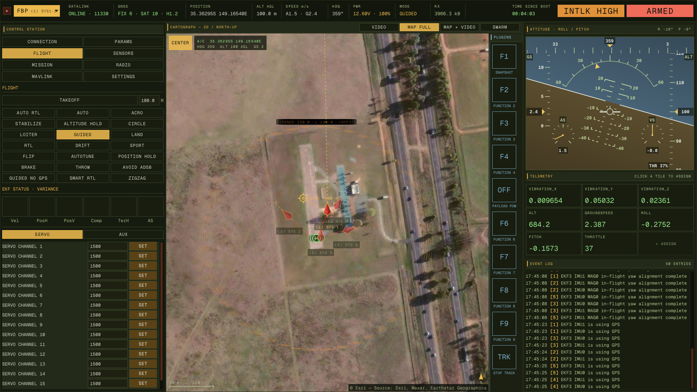
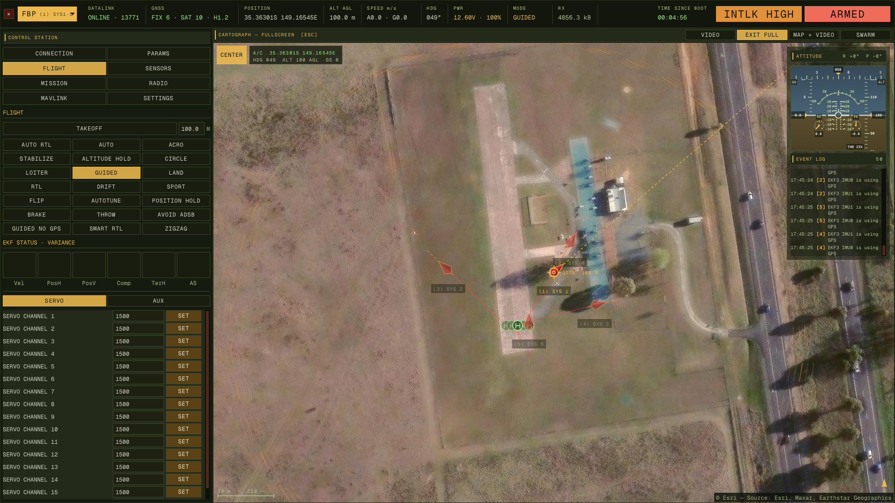
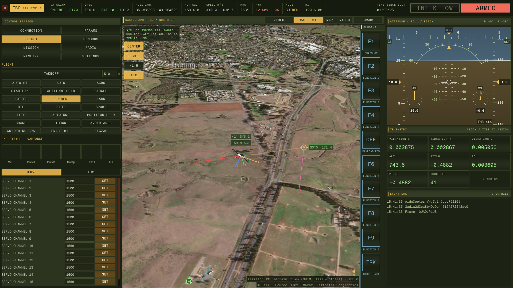

The map draws every vehicle that has a position, not only the one the panels
are following. Each aircraft carries a label above it — `(2) SYS 1`, the GCS's
number then the sysid it reports — and under that its height above the terrain
data, red and saying **BELOW TERRAIN** when it is inside it. The selected
aircraft keeps full colour and a heading line run out to the edge of the panel,
while the rest are dimmed with a short stub so three aircraft do not lay three
dotted lines across the imagery.



Behind each aircraft is its **trail**, recorded off the live stream rather than
off what is on screen: an aircraft that flew while you were watching another one
still has its track when you switch back. Points are thinned to one every 3 m,
so a vehicle standing still does not smudge, and capped at 6000 — about 18 km of
ground track. Each vehicle's **home**, from `HOME_POSITION`, is drawn as a
helipad: an H inside its circle, in green so it reads as neither the aircraft
nor an instruction to it.

**CENTER** — the map follows the selected aircraft until you drag it. The
**CENTER** button in the map's top-left corner, lit while following, puts the
map back on the aircraft and keeps it there. It follows whichever vehicle is
selected, so after switching vehicles it centres on the new one.

**GO HERE** — click anywhere on the map for a guided position target; a drag
still pans. In [3D](#3d-view) the click starts a pick of the point's place and
then its height. The small menu at the pointer shows the coordinates under the
cursor (click them to copy, as signed decimal degrees) and an altitude, which
starts at the height the vehicle is already holding, and **GO** sends it as
`SET_POSITION_TARGET_GLOBAL_INT`. It only sends while the vehicle is in GUIDED,
which is the only mode that acts on one; out of GUIDED the button is disabled
and says why, rather than sending into silence. The menu also checks the
straight line from the vehicle to the point against the terrain. The target
stays drawn as a ringed crosshair joined to the aircraft by a line until
**Clear target** in the map's right-click menu, which also carries **Clear
track** for the trail.

**MAP FULL** — with the map alone in the centre view, the map button relabels
itself. Press it and the map takes the right sidebar's width and the plugin
rail's column; the left sidebar stays, because the tabs are how a mission is
planned and the map is what it is planned on. Attitude and the event log come
back as a semi-transparent block in the map's top-right corner, small enough to
read the map past. Click either half and it grows to the size it had in the
sidebar, text and all, until you click somewhere else; it always comes back
small the next time the map goes fullscreen. **ESC** or **EXIT FULL** restores.



## Map sources

Choose where the imagery comes from in **SETTINGS → MAP SOURCE**, then press **APPLY**. The
map changes at once and shows nothing from the previous source.

| Provider | Key | What to know |
|---|---|---|
| **Esri World Imagery** (default) | Optional ArcGIS key | Works without a key, but Esri's staff say the service [needs a licence and isn't for commercial use](https://community.esri.com/t5/arcgis-location-platform-developers-ques/inquiry-about-world-imagery/m-p/1569266). This project has no agreement with Esri. An invalid key shows no error: in testing, Esri served imagery for a made-up token |
| **Sentinel-2 Cloudless** | None | [EOX's](https://cloudless.eox.at/) cloud-free mosaic of Copernicus data, 10 m per pixel: you can make out valleys, roads and towns, not individual buildings. It stops at zoom 14 and is stretched past that. The 2024 mosaic is [CC BY-NC-SA](https://cloudless.eox.at/documentation/license): free for non-commercial use, and commercial use needs a licence from EOX |
| **NASA GIBS** | None | [NASA's imagery service](https://nasa-gibs.github.io/gibs-api-docs/): pick a **Layer**, listed below. These are coarse, and stretched past their last zoom, so they suit regional views rather than placing waypoints. See [NASA's data use guidance](https://www.earthdata.nasa.gov/engage/open-data-services-software-policies/data-use-guidance) |
| **OpenStreetMap** | None | A street map, not satellite imagery. Its [tile policy](https://operations.osmfoundation.org/policies/tiles/) doesn't permit offline use, and access can be blocked without notice |
| **Google Satellite** | Optional: a Map Tiles API key | With a key, the official API, [billed to your Google account](https://developers.google.com/maps/documentation/tile). Without one, an unofficial endpoint that Google's terms do not provide for and that could stop working at any time; check Google's terms before using it, especially commercially. Tiles from the endpoint are cached on disk like other sources'. API tiles are not, because Google's [policy](https://developers.google.com/maps/documentation/tile/policies) forbids storing them |
| **Custom URL** | Optional | Any tile server. Use `{z}`, `{x}` and `{y}`, `{s}` for numbered servers 0 to 3, and `{key}` where it wants the key. Set the attribution it requires |

Keyless Esri and Google, and custom URLs, are sent a desktop Firefox User-Agent for your platform, as other ground stations send. The keyed APIs, EOX and NASA are told it's freebodyproblem. So is OpenStreetMap, even through a custom URL, because its policy forbids impersonating a browser.

**Data** chooses what's fetched, for the providers that offer a choice:

| Provider | Satellite | Hybrid | Terrain |
|---|---|---|---|
| **Esri** | World Imagery | Imagery with places and boundaries | World Topo Map |
| **Google** | Satellite | Satellite with roads and labels | Terrain with roads and labels |
| **Sentinel-2** | 2024 mosaic | Mosaic with EOX's streets, which draw heavily over the imagery | EOX's terrain layer |

An ArcGIS key applies to Esri's satellite data only, since Esri's keyed host doesn't serve the other two.

**NASA GIBS layers:**

| Layer | Dated | Last zoom | Good for |
|---|---|---|---|
| HLS Sentinel-2, true color, 30 m | Yes | 12 | Recent imagery, on a clear day |
| Landsat true color, 30 m | No, around 2000 | 12 | An old but sharp base map, with gaps over some mountains |
| Landsat infrared, bands 7-4-3 and 1-5-7, 30 m | No, around 2000 | 12 | Telling vegetation, bare ground and water apart in detail |
| VIIRS shortwave infrared, M11-I2-I1 | Daily | 9 | Current vegetation, water and burn scars at a regional scale |
| VIIRS snow and cloud, M3-I3-M11 | Daily | 9 | Telling snow and ice from cloud |
| VIIRS thermal infrared, band I5, day | Daily | 9 | Brightness temperature: mostly cloud tops and warm ground |
| ASTER shaded relief | No | 12 | The shape of the land |

A dated layer takes a **Date (UTC)**: type one, or step with the arrows, and the map updates at once so you can look for a clear day. Each date shows only that day's satellite passes, so expect cloud and gaps, and `No imagery in some tiles` in the credit where a tile has none. GIBS sometimes returns a blank tile for a good request, so a blank is asked for up to 3 more times, and is never cached. GIBS has no recent infrared at 30 m: for that resolution the infrared layers are from around 2000.

If a source refuses or can't be reached, each tile is tried at most 3 times, so the app doesn't keep sending requests. Press **APPLY** to try again.

**Use without an API key at your own risk; it might stop working. You are responsible for following the terms of the source you choose.** Being free and open
source does not grant this project or its users any right to a provider's imagery, and any of
these services could stop working at any time, so don't depend on the imagery in flight.

If a source can't be used, the map's credit line says why, for example `Map unavailable: Map source
refused the request (HTTP 403)`, and so does the settings panel. Keys are stored unencrypted in `settings.json`,
so anyone who can read that file can use them, and they are never written to the log.

## 3D view

**3D**, under **CENTER** in the map's top-left corner, stands the map on the
terrain. Drag to orbit, right-drag to pan, wheel to zoom; the camera keeps
above the ground between it and what it looks at, so a valley never turns the
view into rock. The button under **3D** — **×1.5** to begin with — steps the
vertical exaggeration through 1, 1.5 and 2, and **TEX** swaps the imagery for
the bare elevation mesh. The view needs OpenGL 3.3; where the driver lacks it,
the button says so and stays off.



- **Aircraft** are drawn as models of their type — multicopter, plane or
  helicopter — at their reported altitude and attitude, white with the livery
  in red and navigation lights red to port, green to starboard. Propellers and
  rotors turn while the vehicle is armed. Each carries its body axes (X forward
  in amber, Y right in green, Z down in blue), a pink line down to the ground
  under it, and above it its name and height above the terrain. Any part of an
  aircraft inside the terrain shows through the ground as an amber cage, and
  its label says **BELOW TERRAIN**.
- **The mission** is drawn as its path with a translucent blue band hanging
  from it to the ground, so how high each leg runs over the terrain — and where
  the ground rises to meet it — reads from any angle. Legs too close to the
  terrain are marked as in the mission tab.
- **The geofence** stands as walls: green for inclusion zones and the
  parameter cylinder, red for exclusion zones, up to `FENCE_ALT_MAX` above home
  where a ceiling is set. A fence that is not enabled is not drawn.
- **Placing a point** takes two clicks: the first on the ground fixes where,
  then the point rides its vertical line with the pointer and the second click
  sets its height. A mission item's **LOC?** works this way in 3D, and so does
  **GO HERE**, which then opens its menu with that height filled in. Fence
  drawing and editing are flat-map work and leave 3D.
- **EDIT** works in 3D. Drag a waypoint's marker to move it over the ground at
  the same height, or drag its vertical line up and down to change only its
  height. A drag anywhere else still orbits.

The terrain comes from AWS Terrain Tiles (SRTM, ±25 m) unless another
`{z}/{x}/{y}` PNG source is set in **Settings → TERRAIN**, which also sets the
clearance a planned path must keep from it.

Terrain data credits, as [its licence](https://github.com/tilezen/joerd/blob/master/docs/attribution.md) requires:

```
* Mapzen
* ArcticDEM terrain data DEM(s) were created from DigitalGlobe, Inc., imagery and
  funded under National Science Foundation awards 1043681, 1559691, and 1542736;
* Australia terrain data © Commonwealth of Australia (Geoscience Australia) 2017;
* Austria terrain data © offene Daten Österreichs – Digitales Geländemodell (DGM)
  Österreich;
* Canada terrain data contains information licensed under the Open Government
  Licence – Canada;
* Europe terrain data produced using Copernicus data and information funded by the
  European Union - EU-DEM layers;
* Global ETOPO1 terrain data U.S. National Oceanic and Atmospheric Administration
* Mexico terrain data source: INEGI, Continental relief, 2016;
* New Zealand terrain data Copyright 2011 Crown copyright (c) Land Information New
  Zealand and the New Zealand Government (All rights reserved);
* Norway terrain data © Kartverket;
* United Kingdom terrain data © Environment Agency copyright and/or database right
  2015. All rights reserved;
* United States 3DEP (formerly NED) and global GMTED2010 and SRTM terrain data
  courtesy of the U.S. Geological Survey.
```

These are also in [`NOTICE`](https://github.com/lazy-iframe/freebodyproblem/blob/main/NOTICE). Terrain data is free to use under these terms, with
no key. Nothing promises the AWS bucket will stay available, so terrain could stop loading.

:::caution[A planning aid, not a guarantee]
Terrain heights are approximate (about ±25 m) and leave out buildings, trees, wires and
anything else on the ground, so a leg marked as clear can still hit something. The source
data is provided as is, and part of it (ETOPO1) is marked not to be used for navigation.
Check the route yourself.
:::
