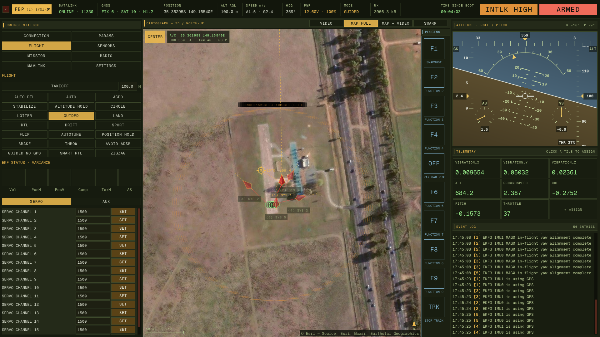
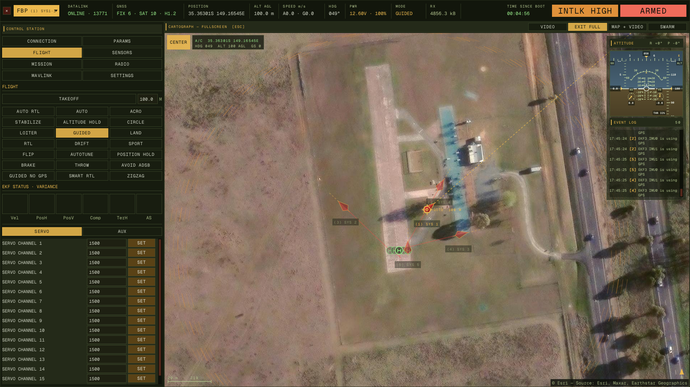

The map draws every vehicle that has a position, not only the one the panels
are following. Each aircraft carries a label — `(2) SYS 1`, the GCS's number
then the sysid it reports — and the selected one keeps full colour and a heading
line run out to the edge of the panel, while the rest are dimmed with a short
stub so three aircraft do not lay three dotted lines across the imagery.

Behind each aircraft is its **trail**, recorded off the live stream rather than
off what is on screen: an aircraft that flew while you were watching another one
still has its track when you switch back. Points are thinned to one every 3 m,
so a vehicle standing still does not smudge, and capped at 6000 — about 18 km of
ground track. Each vehicle's **home**, from `HOME_POSITION`, is drawn as a
helipad: an H inside its circle, in green so it reads as neither the aircraft
nor an instruction to it.

**CENTER** — the map follows the selected aircraft until you drag it. The
**CENTER** button in the map's top-left corner, lit while following, puts the
map back on the aircraft and keeps it there. It follows whichever vehicle is
selected, so after switching vehicles it centres on the new one.

**GO HERE** — right-click anywhere on the map for a guided position target. The
menu shows the coordinates under the cursor (click them to copy, as signed
decimal degrees) and an altitude, which starts at the
height the vehicle is already holding, and **GO** sends it as
`SET_POSITION_TARGET_GLOBAL_INT`. It only sends while the vehicle is in GUIDED,
which is the only mode that acts on one; out of GUIDED the button is disabled
and says why, rather than sending into silence. The target stays drawn as a
ringed crosshair joined to the aircraft by a line until **CLEAR TARGET**. The
same menu carries **CLEAR TRACK** for the trail.

**MAP FULL** — with the map alone in the centre view, the map button relabels
itself. Press it and the map takes the right sidebar's width and the plugin
rail's column; the left sidebar stays, because the tabs are how a mission is
planned and the map is what it is planned on. Attitude and the event log come
back as a semi-transparent block in the map's top-right corner, small enough to
read the map past. Click either half and it grows to the size it had in the
sidebar, text and all, until you click somewhere else; it always comes back
small the next time the map goes fullscreen. **ESC** or **EXIT FULL** restores.

