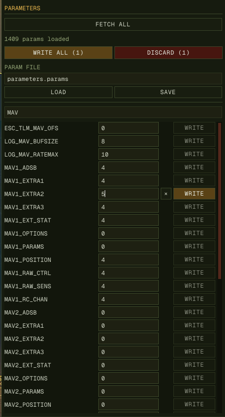
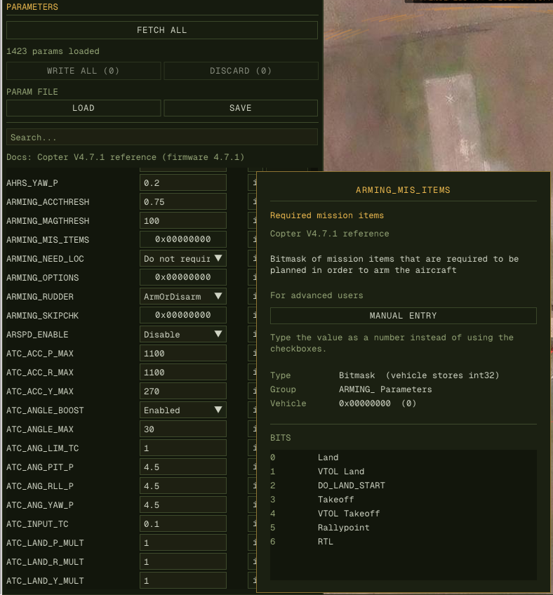

1. Navigate to **PARAMETERS** tab
2. Click **FETCH ALL** to download full parameter set
3. Use search box to filter (e.g., `WPNAV`, `EK2_`)
4. Edit values in-place — each row gets the editor its type calls for: a
   dropdown for an enum, a free number field for an integer or float, and for
   a bitmask its value in hex, which opens to one checkbox per bit (or type
   the hex directly). A number outside its documented range turns amber and
   says so on hover, in the log when written, and in the WRITE ALL
   confirmation, but it is never blocked
5. Click **i** beside a row for everything the firmware documents about it:
   description, units, range, increment, accepted values or bits, whether a
   reboot is needed, and the type the vehicle stores it as. For an enum or a
   bitmask, **MANUAL ENTRY** swaps the row's list or checkboxes
   for a plain number field, for values the reference does not list; hovering
   the field names what the number means. Press it again to switch back
6. Click **WRITE** to commit one change, or **WRITE ALL** to send every edited
   parameter at once (asks for confirmation, and shows the count on the button)
7. Click the **×** beside a changed value to drop that one edit, or **DISCARD**
   next to WRITE ALL to drop every staged change at once

Edits are staged until written: a row whose value differs from the vehicle's
shows an amber **WRITE**, and clears once the vehicle echoes the new value back.
Anything the vehicle misses stays visibly dirty — press again.

Only values *you* moved count as staged. A parameter the vehicle changes on its
own — ArduPilot saves its `STAT_*` counters as it runs, and broadcasts each save
— updates the row in place without ever becoming a pending edit, so WRITE ALL
can never offer to write a stale value back over a newer one.

Under **PARAM FILE**, both **LOAD** and **SAVE** name their file through a
browser rather than a typed path — an in-app one, drawn by the same ImGui pass
as the rest of the panel rather than the desktop's own dialog. Neither reads
nor writes anything until a file has been named, and the browser opens where
the last one left off, so a save after a load lands beside what was loaded.
SAVE asks before overwriting; LOAD does not, having nothing to overwrite.

The documentation comes from each firmware's published parameter reference,
one page per release, merged into a checked-in table. Rerun the script when a
new release comes out:

| Firmware | Releases | Source | Script → table |
|---|---|---|---|
| ArduPilot Copter | every stable release from 4.0.0 | [parameters.html](https://ardupilot.org/copter/docs/parameters.html) and its version picker | `scripts/gen_param_meta_ardupilot.py copter` → `frontend/widgets/param_meta_arducopter.cpp` |
| ArduPilot Plane | every stable release from 4.0.0 | [parameters.html](https://ardupilot.org/plane/docs/parameters.html) and its version picker | `scripts/gen_param_meta_ardupilot.py plane` → `frontend/widgets/param_meta_arduplane.cpp` |
| PX4 | every release from v1.12 (`main` left out) | [parameter_reference](https://docs.px4.io/main/en/advanced_config/parameter_reference) and its version dropdown | `scripts/gen_param_meta_px4.py` → `frontend/widgets/param_meta_px4.cpp` |

The ArduPilot script takes `<copter|plane> <out_cpp> [<cache_dir>]`, the PX4
one `<out_cpp> [<cache_dir>]`; pages already in the cache are not fetched again.

Parameters are renamed and re-documented between releases (`ARMING_CHECK`
became `ARMING_SKIPCHK`, `WPNAV_SPEED` in cm/s became `WP_SPD` in m/s), so once
the vehicle reports its firmware version every row is read against that
release's page, and the tab says which one. PX4 publishes a page per minor
release, so a 1.15.4 vehicle reads v1.15's. A parameter that release's page
leaves out is shown as the nearest release documents it, and **i** says so.
PX4's pages also give each parameter's default, which **i** shows.

ArduPilot's pages name enums and bitmasks but not storage types, so a plain
number is edited as an integer or a float by the type the vehicle reports.
PX4's name the type. A list of values counts as an enum only when every value
is whole and the documented range admits nothing the list leaves out.
Otherwise the values are named points within a range (`ATC_INPUT_TC`'s 0.5
"Very Soft", 0.2 "Soft", … anywhere from 0 to 1; PX4's `GPS_1_PROTOCOL`, whose
range runs past its list), so the field stays free and **i** lists them as
suggested values. A PX4 boolean is a Disabled/Enabled dropdown. ArduPilot's
documentation is per vehicle: Copter's to multirotors and helicopters,
Plane's to fixed-wing and VTOL types (QuadPlanes included); Rover and Sub get
none. PX4's applies to every airframe.

**DISCARD** asks for confirmation because a loaded parameter file can put
hundreds of edits behind it and there is no undo. The per-row **×** does not:
it can only lose one value, and the value it restores is on the vehicle.

<div class="shot-pair">





</div>

## Parameter files

**SAVE** and **LOAD** under the fetch buttons read and write the `.params`
format Mission Planner and QGroundControl use, so files move between all three:

```
